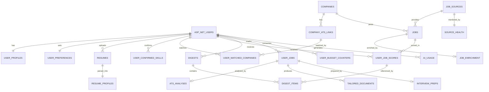

# Database Design — Tailorly Remote

**Version:** 1.0 **Date:** 2026-10-24 **Companions:** `PRD_TailorlyRemote.md` (v1.4), `SystemDesign_TailorlyRemote.md` (v1.3), `ApiDesign_TailorlyRemote.md`
**Audience:** Claude Code / engineering team

This document is the **authoritative schema**. Where the PRD §10 or System Design §12 differ, this document wins (differences are listed in Section 12). EF Core code-first models and migrations are the source of truth in the repo; the DDL below is the reference they must match.

---

## 1. Principles and conventions

| Topic | Rule |
|---|---|
| Engine | PostgreSQL 16+, one database, schemas: `public` (app) and `hangfire` (created by Hangfire) |
| Naming | `snake_case` tables/columns (EF: `EFCore.NamingConventions`). ASP.NET Identity tables become `asp_net_users`, etc. |
| Keys | `uuid` primary keys generated by the app (`Guid.CreateVersion7()` for index locality). Small lookup tables use natural text keys. `bigint identity` for high-volume append-only logs. |
| Time | `timestamptz`, always UTC. Local dates (`local_date`) are plain `date` computed in the user's IANA time zone. |
| Enums | `text` + `CHECK` constraint (no PostgreSQL enum types: easier migrations). |
| JSON | `jsonb` for AI outputs and flexible structures; every such column has a sibling `schema_version`, or the JSON carries one. |
| Strings | `text`, no arbitrary length limits except where stated by CHECK. |
| Deletion | User data: `ON DELETE CASCADE` from `asp_net_users`. Jobs: plain deletes by retention jobs. Never soft-delete user data. |
| Tenancy | Every user-owned table carries `user_id` directly (denormalised on child tables) so the EF global query filter is a one-liner and indexes are efficient. |
| Concurrency | Optimistic concurrency with PostgreSQL `xmin` on rows edited by users (`user_preferences`, `user_jobs`, `tailored_documents`). |
| Idempotency | Enforced with unique / partial unique indexes (Section 6), not with extra tables. |
| Money | Salary stored as whole units per **year** in the stated currency (`bigint`), plus `salary_period_original` for display. |

---

## 2. Entity overview



**Table groups**

| Group | Tables |
|---|---|
| Identity & account | `asp_net_*` (Identity), `user_profiles`, `invite_codes`, `feature_flags`, `audit_log` |
| Résumé | `resumes`, `resume_profiles`, `user_confirmed_skills` |
| Preferences | `user_preferences`, `user_watched_companies` |
| Sources & jobs (shared) | `job_sources`, `source_health`, `companies`, `company_ats_links`, `jobs`, `job_enrichment` |
| Per-user matching | `user_job_scores`, `digests`, `digest_items` |
| Tracker & documents | `user_jobs`, `ats_analyses`, `tailored_documents`, `interview_preps` |
| AI & budgets | `ai_task_config`, `user_budget_counters`, `ai_usage` |

---

## 3. DDL (reference)

> Apply in this order. `asp_net_users(id uuid)` is created by ASP.NET Identity with `Guid` keys.

### 3.1 Account and configuration

```sql
CREATE TABLE user_profiles (
  user_id            uuid PRIMARY KEY REFERENCES asp_net_users(id) ON DELETE CASCADE,
  display_name       text        NOT NULL,
  time_zone          text        NOT NULL DEFAULT 'Asia/Kolkata',      -- IANA name
  notification_email text        NOT NULL,
  account_status     text        NOT NULL DEFAULT 'active'
                     CHECK (account_status IN ('active','pending_deletion','suspended')),
  consent_version    text,
  consented_at       timestamptz,
  consent_ip_hash    text,
  created_at         timestamptz NOT NULL DEFAULT now(),
  updated_at         timestamptz NOT NULL DEFAULT now()
);

CREATE TABLE invite_codes (
  code        text PRIMARY KEY,
  max_uses    int  NOT NULL DEFAULT 1 CHECK (max_uses > 0),
  used_count  int  NOT NULL DEFAULT 0 CHECK (used_count >= 0),
  expires_at  timestamptz
);

CREATE TABLE feature_flags (
  key    text  PRIMARY KEY,
  value  jsonb NOT NULL
);

CREATE TABLE audit_log (
  id            bigint GENERATED ALWAYS AS IDENTITY PRIMARY KEY,
  at            timestamptz NOT NULL DEFAULT now(),
  actor_user_id uuid REFERENCES asp_net_users(id) ON DELETE SET NULL,
  action        text NOT NULL,                 -- e.g. 'account.delete.requested', 'admin.ai_config.updated'
  entity        text,
  entity_id     text,
  meta          jsonb                          -- ids and sizes only; never résumé or job text
);
CREATE INDEX ix_audit_log_at ON audit_log (at DESC);
```

### 3.2 Résumés

```sql
CREATE TABLE resumes (
  id                uuid PRIMARY KEY,
  user_id           uuid NOT NULL REFERENCES asp_net_users(id) ON DELETE CASCADE,
  version           int  NOT NULL,                              -- 1,2,3... per user
  original_filename text NOT NULL,
  size_bytes        int  NOT NULL,
  storage_key       text NOT NULL,                              -- {userId}/resumes/{id}/original.docx
  sha256            text NOT NULL,
  is_active         boolean NOT NULL DEFAULT false,
  parse_status      text NOT NULL DEFAULT 'queued'
                    CHECK (parse_status IN ('queued','running','ready','failed')),
  error_code        text,
  format_findings   jsonb,                                      -- LayoutAnalyzer output (tables, columns, images, fonts...)
  created_at        timestamptz NOT NULL DEFAULT now(),
  UNIQUE (user_id, version)
);
CREATE UNIQUE INDEX ux_resumes_one_active ON resumes (user_id) WHERE is_active;

CREATE TABLE resume_profiles (
  resume_id      uuid PRIMARY KEY REFERENCES resumes(id) ON DELETE CASCADE,
  user_id        uuid NOT NULL REFERENCES asp_net_users(id) ON DELETE CASCADE,
  parsed         jsonb NOT NULL,                                 -- AI output (contact, skills, experience, education...)
  user_edited    jsonb,                                          -- user's corrections (null = none)
  schema_version int   NOT NULL DEFAULT 1,
  prompt_version text,
  updated_at     timestamptz NOT NULL DEFAULT now()
);

CREATE TABLE user_confirmed_skills (                             -- facts the user confirmed for tailoring
  id          uuid PRIMARY KEY,
  user_id     uuid NOT NULL REFERENCES asp_net_users(id) ON DELETE CASCADE,
  skill       text NOT NULL,
  skill_key   text NOT NULL,                                     -- lower-cased, trimmed
  created_at  timestamptz NOT NULL DEFAULT now(),
  UNIQUE (user_id, skill_key)
);
```

### 3.3 Preferences and watch list

```sql
CREATE TABLE user_preferences (
  user_id                  uuid PRIMARY KEY REFERENCES asp_net_users(id) ON DELETE CASCADE,
  search_scope             text NOT NULL DEFAULT 'india_plus_global_remote'
                           CHECK (search_scope IN ('india_only','india_plus_global_remote','global_remote_only')),
  target_roles             text[] NOT NULL DEFAULT '{}',
  locations                text[] NOT NULL DEFAULT '{}',
  work_modes               text[] NOT NULL DEFAULT '{remote}',     -- remote|hybrid|onsite
  job_types                text[] NOT NULL DEFAULT '{full_time}',  -- full_time|contract|part_time|internship
  hiring_models            text[] NOT NULL DEFAULT '{employee,contractor}',
  salary_min               bigint CHECK (salary_min IS NULL OR salary_min >= 0),
  salary_max               bigint CHECK (salary_max IS NULL OR salary_max >= 0),
  salary_currency          text NOT NULL DEFAULT 'INR' CHECK (salary_currency IN ('INR','USD')),
  experience_level         text,
  min_match_score          smallint NOT NULL DEFAULT 8 CHECK (min_match_score BETWEEN 1 AND 10),
  include_unspecified_salary boolean NOT NULL DEFAULT true,
  show_unclear_eligibility boolean NOT NULL DEFAULT false,
  timezone_overlap         text,
  excluded_companies       text[] NOT NULL DEFAULT '{}',
  excluded_keywords        text[] NOT NULL DEFAULT '{}',
  schedule_enabled         boolean NOT NULL DEFAULT true,
  schedule_local_time      time NOT NULL DEFAULT '18:00',
  digest_when_empty        boolean NOT NULL DEFAULT false,
  updated_at               timestamptz NOT NULL DEFAULT now(),
  CHECK (salary_max IS NULL OR salary_min IS NULL OR salary_max >= salary_min)
);

CREATE TABLE user_watched_companies (
  user_id              uuid NOT NULL REFERENCES asp_net_users(id) ON DELETE CASCADE,
  company_ats_link_id  uuid NOT NULL,                              -- FK added after company_ats_links exists
  created_at           timestamptz NOT NULL DEFAULT now(),
  PRIMARY KEY (user_id, company_ats_link_id)
);
```

### 3.4 Sources, companies, jobs (shared tables; no user data)

```sql
CREATE TABLE job_sources (
  key                          text PRIMARY KEY,                 -- himalayas, remoteok, jobicy, wwr, greenhouse, lever, ashby, byo
  display_name                 text NOT NULL,
  kind                         text NOT NULL CHECK (kind IN ('feed','board','user')),
  enabled                      boolean NOT NULL DEFAULT true,
  requires_attribution         boolean NOT NULL DEFAULT false,
  attribution_text            text,
  attribution_url              text,
  terms_url                    text,
  terms_reviewed_at            timestamptz,
  require_source_apply_url     boolean NOT NULL DEFAULT false,
  forbid_third_party_resolution boolean NOT NULL DEFAULT false,
  purge_on_expiry              boolean NOT NULL DEFAULT false,
  requires_logo_attribution    boolean NOT NULL DEFAULT false,
  poll_interval_minutes        int NOT NULL DEFAULT 360 CHECK (poll_interval_minutes > 0)
);

CREATE TABLE source_health (
  source_key           text PRIMARY KEY REFERENCES job_sources(key) ON DELETE CASCADE,
  last_success_at      timestamptz,
  last_cursor          text,
  last_failure_at      timestamptz,
  last_error           text,                                      -- short message, no payloads
  consecutive_failures int NOT NULL DEFAULT 0,
  circuit_open_until   timestamptz,
  calls_this_month     int NOT NULL DEFAULT 0,
  calls_period         text,                                      -- 'YYYY-MM'
  last_run_stats       jsonb                                      -- fetched/new/duplicate/failed counts
);

CREATE TABLE companies (
  id               uuid PRIMARY KEY,
  name             text NOT NULL,
  normalized_name  text NOT NULL,
  website_domain   text,
  created_at       timestamptz NOT NULL DEFAULT now()
);
CREATE UNIQUE INDEX ux_companies_normalized ON companies (normalized_name);
CREATE INDEX ix_companies_domain ON companies (website_domain) WHERE website_domain IS NOT NULL;

CREATE TABLE company_ats_links (
  id               uuid PRIMARY KEY,
  company_id       uuid NOT NULL REFERENCES companies(id) ON DELETE CASCADE,
  platform         text NOT NULL CHECK (platform IN ('greenhouse','lever','ashby')),
  board_token      text NOT NULL CHECK (board_token ~ '^[a-z0-9_-]{2,60}$'),
  status           text NOT NULL DEFAULT 'resolved' CHECK (status IN ('resolved','not_found','blocked')),
  origin           text NOT NULL CHECK (origin IN ('seed','user','discovered','guessed','admin')),
  confidence       text NOT NULL DEFAULT 'high' CHECK (confidence IN ('high','medium','low')),
  last_checked_at  timestamptz,
  next_retry_at    timestamptz,
  failure_count    int NOT NULL DEFAULT 0,
  open_jobs_count  int,
  created_at       timestamptz NOT NULL DEFAULT now(),
  UNIQUE (platform, board_token)
);
CREATE INDEX ix_company_ats_links_company ON company_ats_links (company_id);
CREATE INDEX ix_company_ats_links_poll ON company_ats_links (status, next_retry_at);

ALTER TABLE user_watched_companies
  ADD CONSTRAINT fk_watched_link FOREIGN KEY (company_ats_link_id)
  REFERENCES company_ats_links(id) ON DELETE CASCADE;

CREATE TABLE jobs (                                              -- one row per source listing
  id                       uuid PRIMARY KEY,
  source_key               text NOT NULL REFERENCES job_sources(key),
  external_id              text NOT NULL,
  dedupe_key               text NOT NULL,
  duplicate_of_job_id      uuid REFERENCES jobs(id) ON DELETE SET NULL,   -- non-null = suppressed duplicate
  company_id               uuid REFERENCES companies(id) ON DELETE SET NULL,
  company_name             text NOT NULL,
  title                    text NOT NULL,
  location_text            text,
  location_class           text NOT NULL DEFAULT 'unknown',       -- remote-worldwide | remote-region:X | city:Y | unknown
  work_mode                text CHECK (work_mode IN ('remote','hybrid','onsite')),
  employment_type          text CHECK (employment_type IN ('full_time','contract','part_time','internship')),
  hiring_model_hint        text CHECK (hiring_model_hint IN ('employee','contractor','unknown')),
  salary_min               bigint,
  salary_max               bigint,
  salary_currency          char(3),
  salary_period_original   text,                                   -- hour|day|week|month|year as published
  salary_kind              text NOT NULL DEFAULT 'unknown' CHECK (salary_kind IN ('stated','estimated','unknown')),
  description_text         text,                                   -- plain text only (HTML stripped)
  description_completeness text NOT NULL DEFAULT 'limited' CHECK (description_completeness IN ('full','limited')),
  apply_url                text NOT NULL,
  source_url               text NOT NULL,                          -- the listing page on the source (attribution link)
  source_meta              jsonb,                                  -- structured fields e.g. countries, timezones, isWorldwide
  content_hash             text,
  posted_at                timestamptz,
  fetched_at               timestamptz NOT NULL DEFAULT now(),
  expires_at               timestamptz,
  closed_at                timestamptz,                            -- removed from source board
  created_at               timestamptz NOT NULL DEFAULT now(),
  search_tsv               tsvector GENERATED ALWAYS AS
                           (to_tsvector('simple', coalesce(title,'') || ' ' || coalesce(company_name,''))) STORED,
  UNIQUE (source_key, external_id)
);
CREATE INDEX ix_jobs_dedupe ON jobs (dedupe_key);
CREATE INDEX ix_jobs_created ON jobs (created_at DESC)
  WHERE duplicate_of_job_id IS NULL AND closed_at IS NULL;
CREATE INDEX ix_jobs_expires ON jobs (expires_at) WHERE expires_at IS NOT NULL;
CREATE INDEX ix_jobs_search ON jobs USING gin (search_tsv);

CREATE TABLE job_enrichment (
  job_id         uuid PRIMARY KEY REFERENCES jobs(id) ON DELETE CASCADE,
  data           jsonb NOT NULL,                                   -- skills, seniority, eligibility evidence, summary...
  eligibility    text  NOT NULL CHECK (eligibility IN ('worldwide','india_eligible','restricted','unclear')),
  model          text  NOT NULL,
  prompt_version text,
  schema_version int   NOT NULL DEFAULT 1,
  created_at     timestamptz NOT NULL DEFAULT now()
);
CREATE INDEX ix_job_enrichment_eligibility ON job_enrichment (eligibility);
```

### 3.5 Per-user matching and digests

```sql
CREATE TABLE user_job_scores (
  id             uuid PRIMARY KEY,
  user_id        uuid NOT NULL REFERENCES asp_net_users(id) ON DELETE CASCADE,
  job_id         uuid NOT NULL REFERENCES jobs(id) ON DELETE CASCADE,
  resume_version int  NOT NULL,
  fit_score      smallint NOT NULL CHECK (fit_score BETWEEN 1 AND 10),
  reasons        jsonb NOT NULL,                                   -- ["...", "..."]
  matched_skills jsonb NOT NULL DEFAULT '[]',
  missing_skills jsonb NOT NULL DEFAULT '[]',
  confidence     text NOT NULL CHECK (confidence IN ('high','medium','low')),
  model          text NOT NULL,
  prompt_version text,
  created_at     timestamptz NOT NULL DEFAULT now(),
  UNIQUE (user_id, job_id, resume_version)
);
CREATE INDEX ix_scores_user_created ON user_job_scores (user_id, created_at DESC);

CREATE TABLE digests (
  id               uuid PRIMARY KEY,
  user_id          uuid NOT NULL REFERENCES asp_net_users(id) ON DELETE CASCADE,
  kind             text NOT NULL CHECK (kind IN ('scheduled','manual')),
  local_date       date NOT NULL,                                  -- date in the user's time zone when claimed
  status           text NOT NULL DEFAULT 'queued' CHECK (status IN ('queued','running','ready','failed')),
  attempt          int  NOT NULL DEFAULT 1,
  error_code       text,
  jobs_considered  int,
  jobs_scored      int,
  degraded         boolean NOT NULL DEFAULT false,                 -- true if rule-based fallback was used
  started_at       timestamptz,
  finished_at      timestamptz,
  emailed_at       timestamptz,
  created_at       timestamptz NOT NULL DEFAULT now()
);
CREATE UNIQUE INDEX ux_digest_scheduled_per_day ON digests (user_id, local_date) WHERE kind = 'scheduled';
CREATE UNIQUE INDEX ux_digest_manual_inflight ON digests (user_id)
  WHERE kind = 'manual' AND status IN ('queued','running');
CREATE INDEX ix_digests_user_created ON digests (user_id, created_at DESC);

CREATE TABLE digest_items (
  digest_id  uuid NOT NULL REFERENCES digests(id) ON DELETE CASCADE,
  score_id   uuid NOT NULL REFERENCES user_job_scores(id) ON DELETE CASCADE,
  user_id    uuid NOT NULL REFERENCES asp_net_users(id) ON DELETE CASCADE,
  rank       smallint NOT NULL,
  PRIMARY KEY (digest_id, score_id)
);
```

### 3.6 Tracker and documents

```sql
CREATE TABLE user_jobs (                                         -- tracker entry; also holds BYO jobs
  id                 uuid PRIMARY KEY,
  user_id            uuid NOT NULL REFERENCES asp_net_users(id) ON DELETE CASCADE,
  job_id             uuid REFERENCES jobs(id) ON DELETE SET NULL,  -- null for BYO or after the job expired
  is_byo             boolean NOT NULL DEFAULT false,
  -- minimal snapshot so the card still renders after the job row is deleted
  title              text NOT NULL,
  company_name       text NOT NULL,
  apply_url          text,
  source_key         text,                                         -- 'byo' for pasted jobs
  source_name        text,
  attribution_url    text,
  -- user-supplied content
  user_description   text,                                         -- pasted description (BYO or limited job)
  user_enrichment    jsonb,                                        -- enrichment computed from user_description
  status             text NOT NULL DEFAULT 'saved'
                     CHECK (status IN ('saved','tailored','applied','interviewing','offer','rejected','withdrawn')),
  notes              text,
  fit_score          smallint CHECK (fit_score BETWEEN 1 AND 10),  -- copied from user_job_scores or computed for BYO
  ats_before         smallint CHECK (ats_before BETWEEN 0 AND 100),
  ats_after          smallint CHECK (ats_after BETWEEN 0 AND 100),
  status_history     jsonb NOT NULL DEFAULT '[]',                  -- [{status, at}]
  created_at         timestamptz NOT NULL DEFAULT now(),
  updated_at         timestamptz NOT NULL DEFAULT now()
);
CREATE UNIQUE INDEX ux_user_jobs_job ON user_jobs (user_id, job_id) WHERE job_id IS NOT NULL;
CREATE INDEX ix_user_jobs_status ON user_jobs (user_id, status, updated_at DESC);

CREATE TABLE ats_analyses (                                      -- ATS analysis of the ORIGINAL résumé vs the job
  id                uuid PRIMARY KEY,
  user_job_id       uuid NOT NULL REFERENCES user_jobs(id) ON DELETE CASCADE,
  user_id           uuid NOT NULL REFERENCES asp_net_users(id) ON DELETE CASCADE,
  resume_id         uuid NOT NULL REFERENCES resumes(id) ON DELETE CASCADE,
  status            text NOT NULL DEFAULT 'queued' CHECK (status IN ('queued','running','ready','failed')),
  error_code        text,
  ats_score         smallint CHECK (ats_score BETWEEN 0 AND 100),
  components        jsonb,                                         -- keyword_coverage, requirements_match, ...
  requirements      jsonb,                                         -- [{text,type,status,evidencePids}]
  gaps              jsonb,                                         -- [{skill, likelyHas}]
  findings          jsonb,                                         -- format findings with fix suggestions
  model             text,
  prompt_version    text,
  created_at        timestamptz NOT NULL DEFAULT now(),
  updated_at        timestamptz NOT NULL DEFAULT now(),
  UNIQUE (user_job_id, resume_id)
);

CREATE TABLE tailored_documents (                                -- tailored résumé OR cover letter
  id                   uuid PRIMARY KEY,
  user_job_id          uuid NOT NULL REFERENCES user_jobs(id) ON DELETE CASCADE,
  user_id              uuid NOT NULL REFERENCES asp_net_users(id) ON DELETE CASCADE,
  resume_id            uuid NOT NULL REFERENCES resumes(id) ON DELETE CASCADE,
  kind                 text NOT NULL CHECK (kind IN ('resume','cover_letter')),
  status               text NOT NULL DEFAULT 'queued'
                       CHECK (status IN ('queued','running','proposed','finalizing','ready','failed')),
  error_code           text,
  source_resume_version int NOT NULL,
  edits                jsonb,                                      -- résumé: [{id,paragraphId,fingerprint,newText,rationale,flags,decision}]
  content              jsonb,                                      -- cover letter: {paragraphs:[...], wordCount}
  tone                 text CHECK (tone IS NULL OR tone IN ('concise','confident')),
  ats_after            smallint CHECK (ats_after BETWEEN 0 AND 100),
  ats_breakdown        jsonb,
  storage_key          text,                                       -- final .docx once ready
  model                text,
  prompt_version       text,
  created_at           timestamptz NOT NULL DEFAULT now(),
  updated_at           timestamptz NOT NULL DEFAULT now(),
  finalized_at         timestamptz,
  CHECK ((kind = 'resume' AND tone IS NULL) OR (kind = 'cover_letter'))
);
CREATE UNIQUE INDEX ux_tailored_inflight ON tailored_documents (user_job_id, kind)
  WHERE status IN ('queued','running','finalizing');
CREATE INDEX ix_tailored_user_job ON tailored_documents (user_job_id, created_at DESC);

CREATE TABLE interview_preps (
  id             uuid PRIMARY KEY,
  user_job_id    uuid NOT NULL UNIQUE REFERENCES user_jobs(id) ON DELETE CASCADE,
  user_id        uuid NOT NULL REFERENCES asp_net_users(id) ON DELETE CASCADE,
  status         text NOT NULL DEFAULT 'queued' CHECK (status IN ('queued','running','ready','failed')),
  error_code     text,
  content        jsonb,
  model          text,
  prompt_version text,
  created_at     timestamptz NOT NULL DEFAULT now(),
  updated_at     timestamptz NOT NULL DEFAULT now()
);
```

### 3.7 AI configuration, budgets, usage

```sql
CREATE TABLE ai_task_config (
  task            text PRIMARY KEY,
  model           text NOT NULL,
  fallback_model  text,
  max_tokens      int  NOT NULL CHECK (max_tokens > 0),
  temperature     numeric(3,2) NOT NULL DEFAULT 0.2 CHECK (temperature BETWEEN 0 AND 1),
  bucket          text NOT NULL CHECK (bucket IN ('discovery','documents','platform')),
  enabled         boolean NOT NULL DEFAULT true,
  updated_at      timestamptz NOT NULL DEFAULT now(),
  updated_by      uuid REFERENCES asp_net_users(id) ON DELETE SET NULL
);

CREATE TABLE user_budget_counters (
  user_id       uuid NOT NULL REFERENCES asp_net_users(id) ON DELETE CASCADE,
  period_key    text NOT NULL,                                     -- 'YYYY-MM' in Asia/Kolkata
  bucket        text NOT NULL CHECK (bucket IN ('discovery','documents')),
  limit_tokens  bigint NOT NULL CHECK (limit_tokens >= 0),
  used_tokens   bigint NOT NULL DEFAULT 0 CHECK (used_tokens >= 0),
  PRIMARY KEY (user_id, period_key, bucket)
);

CREATE TABLE ai_usage (
  id                  bigint GENERATED ALWAYS AS IDENTITY PRIMARY KEY,
  user_id             uuid REFERENCES asp_net_users(id) ON DELETE SET NULL,   -- null = platform (enrichment) or user deleted
  task                text NOT NULL,
  model               text NOT NULL,
  prompt_version      text,
  bucket              text NOT NULL,
  period_key          text NOT NULL,
  input_tokens        int  NOT NULL DEFAULT 0,
  output_tokens       int  NOT NULL DEFAULT 0,
  cache_create_tokens int  NOT NULL DEFAULT 0,
  cache_read_tokens   int  NOT NULL DEFAULT 0,
  counted_tokens      int  NOT NULL DEFAULT 0,
  est_cost_usd        numeric(10,5),
  latency_ms          int,
  success             boolean NOT NULL,
  error_code          text,
  created_at          timestamptz NOT NULL DEFAULT now()
);
CREATE INDEX ix_ai_usage_user_period ON ai_usage (user_id, period_key, bucket);
CREATE INDEX ix_ai_usage_platform_day ON ai_usage (created_at) WHERE user_id IS NULL;
```

---

## 4. JSON column shapes (versioned)

| Column | Shape (abridged) |
|---|---|
| `resume_profiles.parsed` | `{contact:{name,email,phone,location,links[]}, summary, skills:[{name,category}], experience:[{company,title,start,end,bullets[]}], education:[...], certifications:[...], totalYears, domains[]}` |
| `resumes.format_findings` | `{hasTables, hasColumns, hasTextBoxes, hasImages, headerFooterText, fonts[], wordCount, trackedChanges, lockedParagraphs, editableParagraphs}` |
| `job_enrichment.data` | Appendix B of the PRD (skills, seniority, years, eligibility + evidence, restricted regions, time-zone requirement, hiring-model hint, salary extracted, summary, skill aliases) |
| `jobs.source_meta` | Himalayas: `{locationRestriction[], timezoneRestriction[], isWorldwide, seniority, categories[]}`; RemoteOK: `{tags[]}`; boards: `{departments[], offices[]}` |
| `ats_analyses.requirements` | `[{text, type: required\|preferred, status: met\|partial\|missing, evidencePids[]}]` |
| `tailored_documents.edits` | `[{id, paragraphId, fingerprint, newText, rationale, flags[], decision: pending\|accepted\|rejected}]` |
| `tailored_documents.content` | `{paragraphs[], wordCount}` |
| `user_jobs.status_history` | `[{status, at}]` |
| `interview_preps.content` | PRD Appendix B (technical topics, behavioural, gaps, questions to ask) |

Every AI-derived JSON is validated against a JSON schema before writing; readers tolerate older `schema_version` values through upcasters in code.

---

## 5. Seed data

```sql
INSERT INTO job_sources
 (key, display_name, kind, requires_attribution, attribution_text, attribution_url,
  require_source_apply_url, forbid_third_party_resolution, purge_on_expiry, requires_logo_attribution, poll_interval_minutes, enabled)
VALUES
 ('himalayas','Himalayas','feed', true,'Source: Himalayas','https://himalayas.app', true,  true,  true,  false, 1440, false), -- enable after written confirmation
 ('remoteok','Remote OK','feed',  true,'Source: Remote OK','https://remoteok.com', true,  false, false, false, 360,  true),
 ('jobicy','Jobicy','feed',       true,'Source: Jobicy','https://jobicy.com',      true,  false, false, false, 360,  false), -- enable after terms check
 ('wwr','We Work Remotely','feed',true,'Source: We Work Remotely','https://weworkremotely.com', true, false, false, false, 360, false),
 ('greenhouse','Greenhouse board','board', false,null,null, false, false, false, false, 360, true),
 ('lever','Lever board','board',  false,null,null, false, false, false, false, 360, false),
 ('ashby','Ashby board','board',  false,null,null, false, false, false, false, 360, false),
 ('byo','Added by you','user',    false,null,null, false, false, false, false, 1440, true);

INSERT INTO source_health (source_key) SELECT key FROM job_sources;

INSERT INTO ai_task_config (task, model, max_tokens, temperature, bucket) VALUES
 ('resume_parse',        'claude-sonnet-5-5', 4000, 0.0, 'documents'),
 ('job_enrichment',      'claude-haiku-5-5',  1500, 0.0, 'platform'),
 ('byo_job_enrichment',  'claude-haiku-5-5',  1500, 0.0, 'documents'),
 ('job_fit_score',       'claude-haiku-5-5',   600, 0.0, 'discovery'),
 ('ats_analysis',        'claude-sonnet-5-5', 3000, 0.0, 'documents'),
 ('resume_tailor',       'claude-sonnet-5-5', 4000, 0.2, 'documents'),
 ('cover_letter',        'claude-sonnet-5-5', 1200, 0.4, 'documents'),
 ('interview_prep',      'claude-sonnet-5-5', 3000, 0.3, 'documents');

INSERT INTO feature_flags (key, value) VALUES
 ('signup.require_invite_code', 'false'),
 ('digest.email_enabled',       'true'),
 ('pdf_export.enabled',         'false');
```

- Model IDs shown are the current names from the product notes; they live only in this table. Verify at build time.
- `himalayas`, `jobicy` and `wwr` ship **disabled** until their terms are confirmed (Himalayas: written reply to the email already sent).
- `watched_companies.seed.json` (≥ 100 boards) is loaded by an admin action into `companies` + `company_ats_links` (`origin='seed'`). Format: `[{ "name": "...", "websiteDomain": "...", "platform": "greenhouse", "boardToken": "..." }]`. Each entry is verified by calling the fixed board URL and recording `open_jobs_count`.

---

## 6. Constraints that replace extra infrastructure

| Guarantee | Mechanism |
|---|---|
| One scheduled digest per user per local day | `ux_digest_scheduled_per_day` + `INSERT … ON CONFLICT (user_id, local_date) WHERE kind='scheduled' DO NOTHING RETURNING id` |
| One manual run in flight per user | `ux_digest_manual_inflight` |
| One active résumé per user | `ux_resumes_one_active` |
| No duplicate in-flight tailoring or cover letter per tracked job | `ux_tailored_inflight` |
| One ATS analysis and one interview prep per tracked job (+résumé) | `UNIQUE (user_job_id, resume_id)`, `UNIQUE (user_job_id)` |
| No re-scoring of the same job for the same résumé version | `UNIQUE (user_id, job_id, resume_version)` |
| One listing per source id | `UNIQUE (source_key, external_id)` |
| One board per platform token | `UNIQUE (platform, board_token)` |
| Safe board tokens (no SSRF through path injection) | `CHECK (board_token ~ '^[a-z0-9_-]{2,60}$')` |
| Valid values everywhere | `CHECK` constraints on all enum-like columns |
| Token counters never negative | `CHECK (used_tokens >= 0)` |

---

## 7. Key queries (implementation reference)

**Digest dispatcher: users due now** (time-zone maths done in PostgreSQL):
```sql
SELECT p.user_id,
       (now() AT TIME ZONE p.time_zone)::date AS local_date
FROM user_profiles p
JOIN user_preferences pr ON pr.user_id = p.user_id
JOIN asp_net_users u     ON u.id = p.user_id AND u.email_confirmed
WHERE p.account_status = 'active'
  AND pr.schedule_enabled
  AND (now() AT TIME ZONE p.time_zone)::time >= pr.schedule_local_time
  AND (now() AT TIME ZONE p.time_zone)::time <  pr.schedule_local_time + interval '4 hours'
  AND EXISTS (SELECT 1 FROM resumes r WHERE r.user_id = p.user_id AND r.is_active AND r.parse_status = 'ready')
  AND NOT EXISTS (SELECT 1 FROM digests d
                  WHERE d.user_id = p.user_id AND d.kind = 'scheduled'
                    AND d.local_date = (now() AT TIME ZONE p.time_zone)::date);
-- then, per row:
INSERT INTO digests (id, user_id, kind, local_date, status)
VALUES (@id, @user, 'scheduled', @local_date, 'queued')
ON CONFLICT (user_id, local_date) WHERE kind = 'scheduled' DO NOTHING
RETURNING id;          -- row returned only for the winner → enqueue PerUserRun
```
(`schedule_local_time + 4 h` caps late catch-up. A schedule near midnight needs the app to handle date rollover; treat a window crossing midnight as a documented edge case.)

**Per-user run: candidate jobs not yet scored for this résumé version**
```sql
SELECT j.*
FROM jobs j
WHERE j.duplicate_of_job_id IS NULL
  AND j.closed_at IS NULL
  AND (j.expires_at IS NULL OR j.expires_at > now())
  AND j.created_at > @since                       -- previous scheduled digest start, bounded to 72 h
  AND NOT EXISTS (SELECT 1 FROM user_job_scores s
                  WHERE s.user_id = @user AND s.job_id = j.id AND s.resume_version = @resumeVersion);
-- further prefilters (roles, scope, work mode, excluded terms) are applied in code on raw fields,
-- then missing job_enrichment rows are created, then eligibility/salary/location prefilters, then scoring.
```

**Budget check and increment** (SDD §9.2):
```sql
SELECT limit_tokens - used_tokens FROM user_budget_counters
WHERE user_id=@u AND period_key=@p AND bucket=@b;                 -- refuse if <= 0

UPDATE user_budget_counters SET used_tokens = used_tokens + @counted
WHERE user_id=@u AND period_key=@p AND bucket=@b;
-- row creation (first use in a period):
INSERT INTO user_budget_counters (user_id, period_key, bucket, limit_tokens)
VALUES (@u,@p,@b,@limit) ON CONFLICT DO NOTHING;
```

**Platform enrichment ceiling (daily)**
```sql
SELECT coalesce(sum(counted_tokens),0) FROM ai_usage
WHERE user_id IS NULL AND task = 'job_enrichment' AND created_at >= date_trunc('day', now() AT TIME ZONE 'Asia/Kolkata') AT TIME ZONE 'Asia/Kolkata';
```

**Dedupe on upsert (per incoming listing)**
```sql
-- 1) upsert the listing itself
INSERT INTO jobs (...) VALUES (...)
ON CONFLICT (source_key, external_id) DO UPDATE
  SET title = EXCLUDED.title, description_text = coalesce(EXCLUDED.description_text, jobs.description_text),
      content_hash = EXCLUDED.content_hash, expires_at = EXCLUDED.expires_at, fetched_at = now()
  WHERE jobs.content_hash IS DISTINCT FROM EXCLUDED.content_hash
RETURNING id, dedupe_key;
-- 2) choose canonical among rows sharing dedupe_key (app code applies PRD §7.1a/§7.4 rules)
SELECT id, source_key, description_completeness, duplicate_of_job_id
FROM jobs WHERE dedupe_key = @key;
-- 3) set duplicate_of_job_id on losers; clear it on the winner
UPDATE jobs SET duplicate_of_job_id = @winner WHERE dedupe_key = @key AND id <> @winner;
UPDATE jobs SET duplicate_of_job_id = NULL      WHERE id = @winner;
```
"Also listed on" is `SELECT source_key, source_url FROM jobs WHERE dedupe_key = @key`.

**Retention sweeps**
```sql
DELETE FROM jobs WHERE coalesce(posted_at, created_at) < now() - interval '60 days';
DELETE FROM jobs j USING job_sources s
  WHERE s.key = j.source_key AND s.purge_on_expiry AND j.expires_at IS NOT NULL AND j.expires_at < now();
DELETE FROM jobs WHERE closed_at < now() - interval '7 days';
DELETE FROM digests WHERE created_at < now() - interval '12 months';
DELETE FROM audit_log WHERE at < now() - interval '12 months';
-- ai_usage: after 13 months aggregate into monthly rows per task/model (user_id NULL) then delete detail
```
Deleting a `jobs` row cascades to `job_enrichment`, `user_job_scores`, `digest_items`; `user_jobs.job_id` becomes NULL and the snapshot columns keep the tracker card intact.

**Stuck-work sweep** (every 15 min)
```sql
UPDATE resumes             SET parse_status='failed', error_code='TIMEOUT' WHERE parse_status IN ('queued','running') AND created_at < now() - interval '30 minutes';
UPDATE tailored_documents  SET status='failed',       error_code='TIMEOUT' WHERE status IN ('queued','running','finalizing') AND updated_at < now() - interval '30 minutes';
-- same pattern for ats_analyses, interview_preps, digests (status IN ('queued','running'))
```

---

## 8. Account deletion order

1. Collect storage keys: `SELECT storage_key FROM resumes WHERE user_id=@u UNION ALL SELECT storage_key FROM tailored_documents WHERE user_id=@u AND storage_key IS NOT NULL;`
2. Delete files (idempotent).
3. `DELETE FROM asp_net_users WHERE id=@u;` — cascades to every user-owned table in this document. `ai_usage.user_id` and `audit_log.actor_user_id` become NULL (anonymised aggregates kept).
4. Append to the off-DB deletion log (SDD §13.4); write an `audit_log` row **before** step 3 with the user id as text and no PII.

---

## 9. EF Core mapping notes

- `EFCore.NamingConventions` → snake_case; `Guid` keys; `DateTimeOffset`/`Instant` as `timestamptz`; `DateOnly` → `date`; `TimeOnly` → `time`.
- `text[]` ↔ `string[]`/`List<string>`; `jsonb` ↔ typed records via `System.Text.Json` (`HasColumnType("jsonb")`).
- **Global query filter** on all user-owned entities: `e.UserId == _currentUser.UserId` (`Guid.Empty` when unauthenticated). User-owned entities: `UserProfile, UserPreferences, Resume, ResumeProfile, UserConfirmedSkill, UserWatchedCompany, UserJobScore, Digest, DigestItem, UserJob, AtsAnalysis, TailoredDocument, InterviewPrep, UserBudgetCounter`. Shared entities (`Job`, `JobEnrichment`, `Company`, `CompanyAtsLink`, `JobSource`, `SourceHealth`, `AiTaskConfig`, `FeatureFlag`, `InviteCode`) have no filter. `AiUsage` and `AuditLog` are written by the system and read only by admin endpoints.
- `IgnoreQueryFilters()` is allowed only in: digest dispatcher, purge job, stuck-work sweep, budget service, admin queries. Keep them in one `SystemQueries` class so review is easy.
- Optimistic concurrency via `xmin` on `UserPreferences`, `UserJob`, `TailoredDocument`; a conflict returns HTTP 409 `CONCURRENT_UPDATE`.
- Enforce partial unique indexes and `CHECK`s in migrations with raw SQL where EF cannot express them.
- Migrations run through `Tailorly.App --migrate` (SDD §12.5). Seed inserts (Section 5) are idempotent (`ON CONFLICT DO NOTHING`) and run by the same command.

---

## 10. Capacity, performance and maintenance

| Table | Rows (100 users, 1 year, upper bound) | Notes |
|---|---|---|
| `jobs` | ≈ 60 days × 2,000 = ~120K live rows | Retention keeps it small; ~8 KB/row average → < 1 GB |
| `job_enrichment` | ≈ 10–30K | On demand only |
| `user_job_scores` | ≈ 100 users × 20 × 365 = ~730K | ~0.5 KB each → < 500 MB; prune with digests at 12 months if needed |
| `ai_usage` | ≈ 1–2M | Aggregate after 13 months |
| `tailored_documents` | ≈ tens of thousands | Files on disk, rows small |

- Default autovacuum is sufficient; `jobs` has steady insert/delete churn, so keep autovacuum on and monitor table bloat monthly.
- Add indexes only after `EXPLAIN` shows a need; the ones listed are those required by the queries above.
- Nightly `pg_dump`; the monthly restore test must include a row-count check for every table.

---

## 11. Data protection mapping

| Data | Table/column | Sensitivity | Notes |
|---|---|---|---|
| Résumé files | `resumes.storage_key` (file on volume) | High | Private storage; Phase 2 envelope encryption |
| Parsed résumé | `resume_profiles.*` | High | Never logged; sent to the AI provider for processing |
| Pasted job text | `user_jobs.user_description` | Medium | User-owned |
| Tailored docs / cover letters | `tailored_documents.*` | High | User-owned |
| Contact data | `asp_net_users`, `user_profiles` | Medium | Email, name, time zone |
| Consent | `user_profiles.consent_*` | Legal | Keep for the life of the account |
| Shared job data | `jobs`, `job_enrichment` | Public-source | Honour per-source retention flags |

---

## 12. Differences from the PRD §10 and System Design §12 (this document wins)

| # | Change | Reason |
|---|---|---|
| DB1 | `job_source_links` dropped; `jobs` is **one row per source listing** with `duplicate_of_job_id` marking suppressed duplicates | Keeps each source's own apply URL/attribution intact (Himalayas rule); "also on" is a query on `dedupe_key` |
| DB2 | `search_runs` merged into `digests` (`kind = scheduled\|manual`, status, counters) | One table for both scheduled and manual runs |
| DB3 | `resume_profiles.confirmed_facts` replaced by table `user_confirmed_skills` | Confirmed skills persist across résumé versions and can be listed/deleted |
| DB4 | `user_watched_companies` added | Path B feeder 2 (user watch list) needs persistence |
| DB5 | `ats_analyses` added | Stores the requirement-level analysis and gaps (previously only scores existed) |
| DB6 | `tailored_documents` stores both résumés and cover letters; adds `content`, `status` `proposed/finalizing`, `user_id`, `resume_id` | Single resource type for both document kinds |
| DB7 | `user_jobs` carries a minimal snapshot (title, company, apply URL, source) and `user_description/user_enrichment` | Tracker survives job expiry/purge; BYO jobs have no `jobs` row |
| DB8 | `digest_items` references `user_job_scores` (no duplicated score columns) | Single source of truth |
| DB9 | `job_sources` gains the compliance flag columns; `kind` added | PRD §7.1a |
| DB10 | `user_id` denormalised onto child tables | Simple, fail-closed global filter |
| DB11 | One-click unsubscribe sets `user_preferences.schedule_enabled = false` | No extra column |

---

*End of document.*
