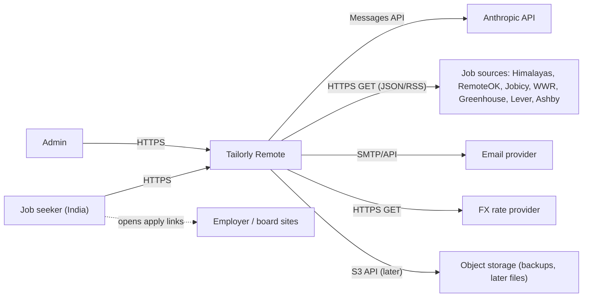
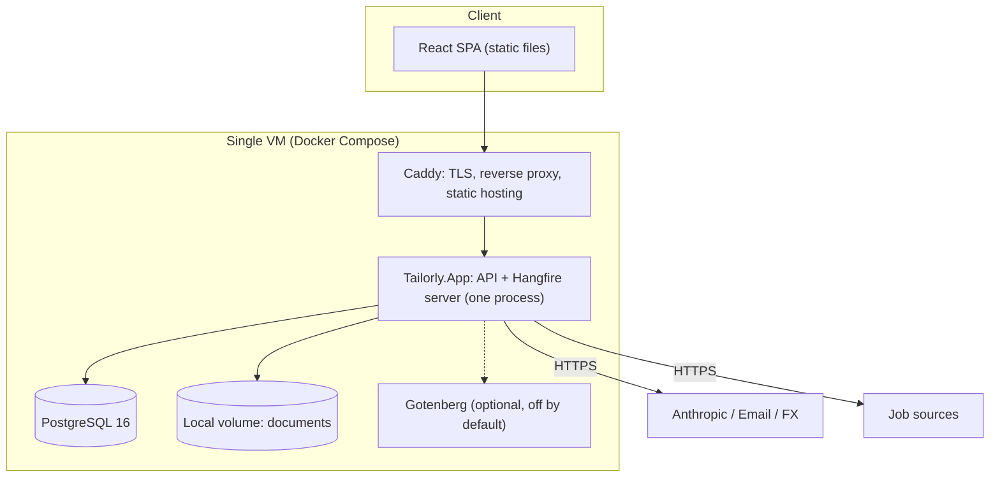
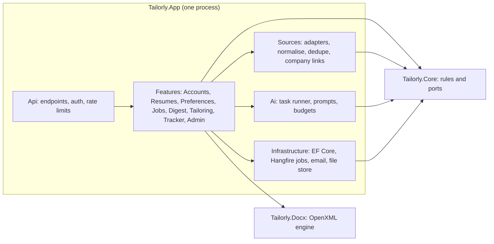
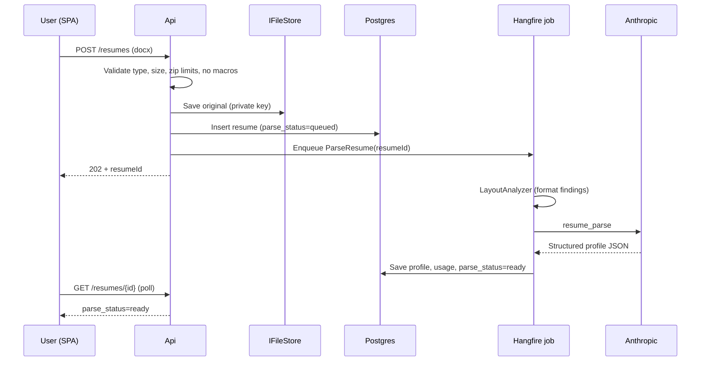
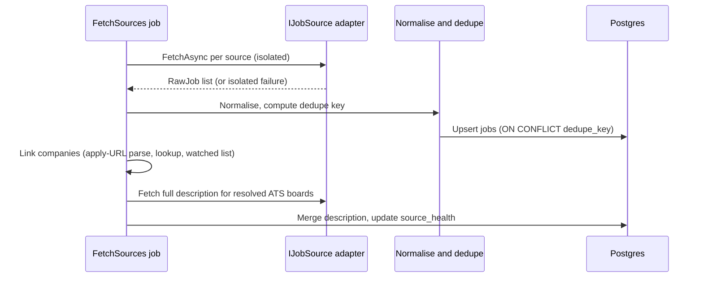
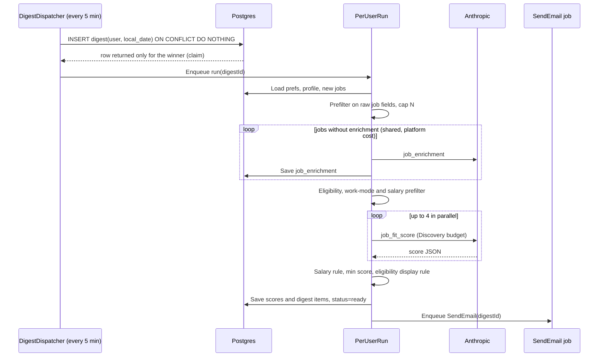
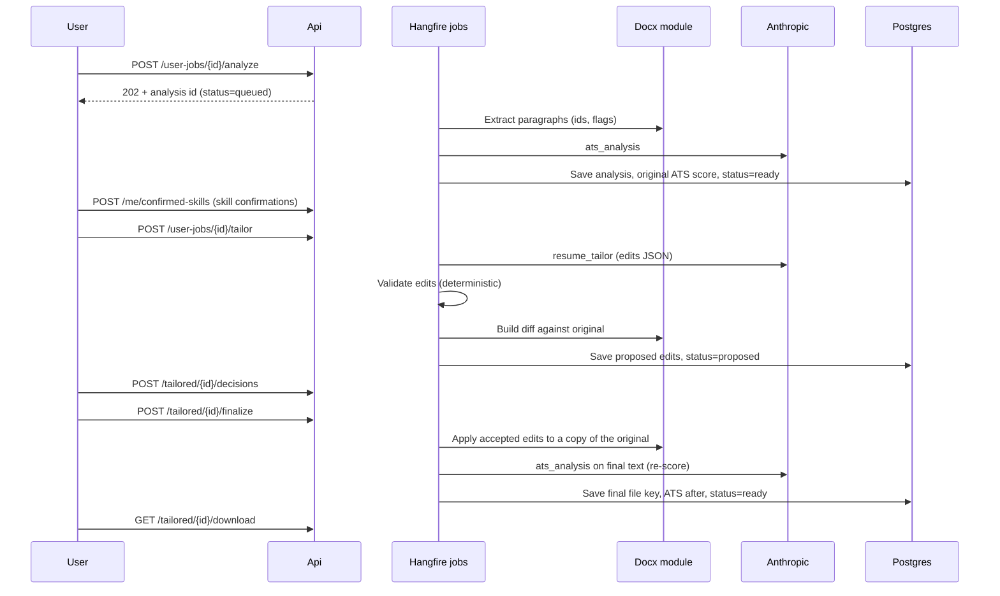
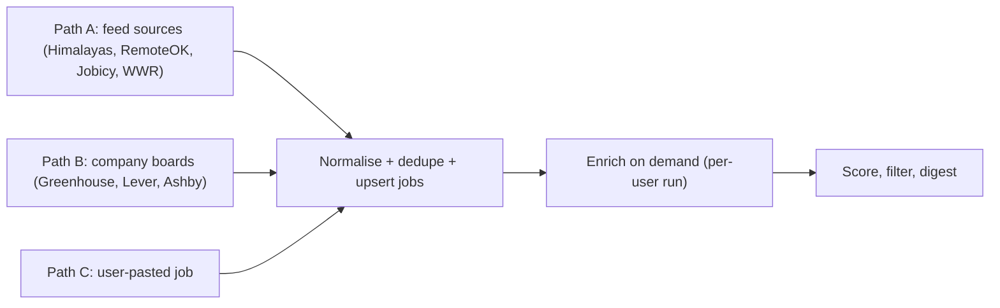
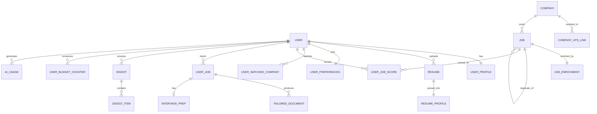

# System Design Document — Tailorly Remote

**Version:** 1.3 (discovery paths; Adzuna removed from MVP) **Date:** 2026-10-24 **Companions:** `PRD_TailorlyRemote.md` (v1.5), `DatabaseDesign_TailorlyRemote.md`, `ApiDesign_TailorlyRemote.md`
**Audience:** Claude Code / engineering team

> Diagrams use Mermaid (renders in GitHub, VS Code, most Markdown viewers).
> Section numbers like "PRD §7.3" refer to the PRD. Where this document **refines or extends** the PRD, it is listed in **Section 17**. If the two conflict, this document wins for *how* to build; the PRD wins for *what* to build.

---

## 1. Purpose and scope

This document describes how Tailorly Remote is structured and why: components, boundaries, data flow, key algorithms, deployment, security, resilience, and evolution. It is detailed enough for an engineer (or Claude Code) to implement each module without further architectural decisions.

**In scope:** MVP architecture (PRD Milestones M0–M6) and the extension points for M7 and Phase 2.
**Out of scope:** UI visual design, copywriting, pricing/billing.

---

## 2. Architectural drivers

### 2.1 Quality attributes (ranked)

| Rank | Attribute | What it means here | Main tactics |
|---|---|---|---|
| 1 | **Truthfulness / correctness** of AI-generated résumé content | Never invent facts; never corrupt the user's document | Edit-only LLM contract, deterministic validators, user diff approval, locked paragraphs |
| 2 | **Data isolation & privacy** | No user can ever see another user's résumé or data | Scoped DbContext, resource-based authz, private storage, tests per endpoint |
| 3 | **Resilience to external failure** | Sources/AI/email will fail; product keeps working | Adapter isolation, circuit breakers, retried jobs, graceful degradation |
| 4 | **Cost control** | AI spend predictable and capped | Two-bucket budgets with hard caps, shared on-demand enrichment, model routing |
| 5 | **Format fidelity** of tailored résumés | Output looks identical to original except edited text | OpenXML in-place edits, no regeneration, round-trip tests |
| 6 | **Operability by a tiny team** | One person can run it | Modular monolith, Postgres-only infra, Docker Compose, strong observability |
| 7 | **Evolvability** | Swap models, sources, email, storage | Interfaces, config-driven routing, ADRs |

### 2.2 Constraints
- .NET backend, React frontend, PostgreSQL (PRD §9).
- No hosted/self-hosted models; Anthropic API only (swappable behind an interface).
- No scraping of sites that forbid automated access; no auto-apply.
- Small user base initially (10–100 users), single-region (India) users, low budget (single VM).
- Résumé input `.docx` only.

### 2.3 Key assumptions for sizing
- ≤ 100 active users in the first year; ≤ 2,000 new jobs ingested per day; ≤ 20 jobs scored per user per run; ≤ 5 tailoring packages per user per week typical.

---

## 3. Architecture style

**Modular monolith, one process.** A single ASP.NET Core application hosts the HTTP API *and* the Hangfire background server, backed by one PostgreSQL database. No message broker, cache server, search engine or orchestrator (ADR-001, ADR-002).

### 3.1 Guiding principles (apply to every decision)
1. **Simplest thing that works.** Add infrastructure, tables or abstractions only when a concrete requirement or a measured problem demands it. Section 17 lists what is deliberately *not* built.
2. **Trust comes from a few strong guarantees, not many moving parts.** The guarantees we do invest in: per-user data isolation (tested on every endpoint), the edit-only AI contract with deterministic validators, unique-constraint idempotency (one digest per user per day), hard token caps, and a tested restore.
3. **Interfaces only at real seams:** AI provider, job sources, email, file storage, FX rates. Everything else is a plain class.

### 3.2 Project structure (3 projects + tests)
| Project | Contents | May depend on |
|---|---|---|
| `Tailorly.Core` | Pure business rules and models: salary rule, eligibility policy, ATS score calculator, budget policy, dedupe key, port interfaces | nothing |
| `Tailorly.Docx` | All OpenXML work (extract, analyse, apply edits, diff, cover-letter writer); its own models | OpenXML SDK only |
| `Tailorly.App` | Everything with I/O: API endpoints, auth, EF Core, Hangfire jobs, source adapters, AI runner, email, file store. Organised as **feature folders** | Core, Docx |
| `Tailorly.Tests` (+ `Tailorly.Eval`) | Unit, integration, format-preservation tests; AI evaluation harness | all |

`Core` and `Docx` are separate because they are pure, heavily tested, and benefit from being impossible to contaminate with I/O. Everything else stays together; split later only if a real need appears. Project references enforce the boundaries, so no separate architecture-test tooling is needed.

---

## 4. System context



Notes:
- The user's browser talks only to Tailorly. Apply links open the employer/board site in a new tab; Tailorly never proxies or automates those sites.
- No inbound webhooks in MVP (simplifies attack surface).

---

## 5. Container view



| Container | Responsibility | Tech |
|---|---|---|
| Caddy | Automatic TLS, HTTP→HTTPS, gzip, serve SPA, reverse proxy `/api` | Caddy 2 |
| Tailorly.App | REST API, auth, validation, background jobs (fetch, digest, AI operations, email, purge), file downloads | ASP.NET Core + Hangfire |
| PostgreSQL | System of record and Hangfire storage | Postgres 16 |
| Documents volume | Résumé originals, tailored docs, cover letters | Local disk behind `IFileStore` |
| Gotenberg (optional) | DOCX→PDF; enabled only with the `pdf` Compose profile | Gotenberg container |

---

## 6. Module view



### 6.1 Real seams (the only interfaces we define)
`IJobSource`, `IModelProvider`, `IEmailSender`, `IFileStore`, `IFxRateProvider`. Each has one production implementation and a test/fake implementation (`FakeModelProvider`, `FakeJobSource`, local file store, Mailpit). Everything else is concrete classes in feature folders.

### 6.2 Requirement-to-component traceability

| PRD feature | Where it lives |
|---|---|
| F1 Account & consent | Features/Accounts, Identity, `SendEmail` job, `PurgeDeletedAccounts` job |
| F2 Résumé | Features/Resumes, Docx (`LayoutAnalyzer`, `ResumeExtractor`), Ai (`resume_parse`), `IFileStore` |
| F3 Preferences | Features/Preferences, Core validation |
| F4 Sourcing | Sources, `FetchSources` job |
| F5 Enrichment | Ai (`job_enrichment`), Sources (pre-rules), called from the per-user run |
| F6 Scoring | Features/Digest, Ai (`job_fit_score`), Core `SalaryRule` |
| F7 Digest | `DigestDispatcher`, `PerUserRun`, `SendEmail` |
| F8 ATS & tailoring | Docx, Ai (`ats_analysis`, `resume_tailor`), Core `AtsScoreCalculator` |
| F9 Cover letter | Ai (`cover_letter`), Docx `CoverLetterWriter` |
| F10 Interview prep | Ai (`interview_prep`) |
| F11 Tracker | Features/Tracker |
| F12 BYO job | Features/Jobs, Ai (`byo_job_enrichment`) |
| F13 Budgets | Ai/Budgets, `ai_usage`, `user_budget_counters` |
| F14 Compliance | `job_sources` flags; API DTOs always carry attribution |
| F15 Admin | Features/Admin, `ai_task_config`, `source_health`, status page |

---

## 7. Key runtime flows

### 7.1 Onboarding: upload and parse résumé



### 7.2 Central fetch cycle (hourly, not per user)



### 7.3 Daily digest (enrichment happens here, on demand)



### 7.4 Tailoring a résumé


The SPA polls the row's `status` (`queued → running → ready | failed`) during each step.

### 7.5 Account deletion
1. `DELETE /account` → email confirmation link (signed, 1 h expiry).
2. On confirm: mark user `pending_deletion`, block login, append `user_id + timestamp` to the **deletion log** stored outside the database (see §13.4), enqueue `PurgeDeletedAccounts`.
3. Purge job (idempotent, resumable): delete files under `{userId}/`, delete rows (`ON DELETE CASCADE` from the user), keep anonymised AI cost aggregates, remove the Identity user, write `audit_log` (no PII).

---

## 8. Detailed design: job sourcing subsystem

### 8.0 Discovery paths (implementation view; requirements in PRD §7.1b)

Three entry paths feed one pipeline:



**Path A (incremental feed fetch).** Each feed adapter implements `GetNewestPage(cursor)`; the shared `FeedRunner` applies the stop rules (older than `since`, all-known page, page cap) and persists `last_cursor` and `last_success_at` in `source_health`. Adapters never decide scheduling or persistence. Himalayas runs two searches (`country=IN`, `worldwide=true`) and merges results by external id; structured fields map straight to `eligibility`.

**Path B (board poller).** `BoardPoller` iterates `company_ats_links` with `status='resolved'` (seed list, user watch list, URL-discovered). Per board: list call without descriptions → diff against stored `external_id`s → detail calls for new ids only → mark missing ids closed. Rate limits per host; 404/410 → `not_found` with weekly retry; each board in its own try/catch.

**Company list feeders:** (1) seed file `watched_companies.seed.json` loaded at startup/migration and verified by an admin action; (2) user watch list; (3) `AddFromApplyUrl` called by the normaliser for RemoteOK/Jobicy/WWR jobs only (never for sources with `forbid_third_party_resolution` or `require_source_apply_url` links that must not be replaced).

**Path C.** `AddByoJob` stores the pasted text; the URL is a plain string, validated (`http/https`) and never fetched.

**Coverage report (M2 deliverable).** An admin page/SQL view counts, per day and per sample role, jobs with `eligibility IN ('worldwide','india_eligible')` by source, so the one-week coverage check can be read directly from the database.

### 8.1 Adapter lifecycle and isolation
- One named `HttpClient` per source, configured with: base address allowlist, timeout (15 s), `User-Agent: TailorlyRemote/1.0 (+contact URL)`, **no automatic redirects across hosts**, resilience pipeline (retry w/ jitter on 5xx/timeout, circuit breaker, rate limiter, bulkhead).
- `FetchSources` creates one child Hangfire job per source; each wraps adapter execution in try/catch and always writes `source_health` (success timestamp or failure + error text). A failing child never fails the parent.
- **Per-source terms flags** (`require_source_apply_url`, `forbid_third_party_resolution`, `purge_on_expiry`, `requires_logo_attribution`, `poll_interval_minutes`; PRD §7.1a) are columns on `job_sources`; adapters and the UI read them, nothing is hard-coded per source.
- **ATS adapters list first, then detail:** poll each board's list endpoint without descriptions and fetch per-job details only for new ids (full-content list responses can be ~2 MB for big boards). Respect documented crawl delays.
- **Expiry:** sources with `purge_on_expiry` (Himalayas) have their job text deleted once the source's `expiresAt` passes; user-owned tracker entries keep only title, company, URL and the user's own notes.
- Per-source `RateLimiter` values live in config (`Sources:{key}:RequestsPerMinute`) so quota-sensitive sources are protected.
- Quota-sensitive sources (if any are added later) keep `calls_this_month` on `source_health`; at ≥ 90% of the configured allowance the adapter reduces its query set and an admin alert is sent.

### 8.2 Normalisation pipeline (pure functions, unit-tested)
`RawJob → clean text (HtmlAgilityPack strip, whitespace) → map work_mode/employment_type → parse salary (structured or regex fallback, currency detection) → compute dedupe_key → JobPosting`

- **Never trust source HTML**: strip all tags/scripts, store plain text only; UI renders as text (no `dangerouslySetInnerHTML`).
- `content_hash = sha256(normalised description)`; upsert updates description only if hash changed; re-enrich only when hash change is material (> 15% token difference or requirements section changed).

### 8.3 Dedupe
`dedupe_key = sha1( norm(company) | norm(title) | location_class )` where `norm()` lowercases, strips punctuation and legal suffixes, and collapses seniority synonyms ("sr." → "senior"); `location_class` = `remote-worldwide | remote-region:{X} | city:{Y}`.
Merge policy: keep the record with `description_completeness = full`; if equal, prefer ATS-sourced; duplicates are marked with `duplicate_of_job_id` (no separate links table; "also on" is a query on `dedupe_key`). **Exception:** a record from a source with `require_source_apply_url` keeps its apply URL; when the same job also exists on an employer ATS board, only the ATS record is shown and the aggregator copy is suppressed (never merged). Near-duplicate detection (title similarity ≥ 0.92 within same company + week) is a SHOULD.

### 8.4 Company → ATS resolution (staged)

**Stage 1 — in MVP (M2):** deterministic and cheap. Runs only for sources without `forbid_third_party_resolution` and without full text (RemoteOK, Jobicy, WWR). **Never** for Adzuna (its terms forbid contacting third parties for its listings) and not needed for Himalayas (full text supplied; its apply link must not be replaced). The MVP also ships a **seed list of ≥ 100 remote-friendly companies' ATS board tokens**, verified by an admin tool, because the watched list is the main route to full-text ATS jobs.
1. **Parse the apply URL.** If it matches a Greenhouse/Lever/Ashby pattern (`boards.greenhouse.io/{token}/jobs/{id}`, `job-boards.greenhouse.io/...`, `jobs.lever.co/{slug}/{id}`, `jobs.ashbyhq.com/{slug}/{id}`), extract platform + board token + job id and store the link (`company_ats_links`).
2. **Lookup** by website domain, then normalised name (lowercase, strip legal suffixes like inc/llc/ltd/pvt/gmbh).
3. **Watched list:** companies the user adds (with board token) or the admin seeds are fetched directly.
4. If a link is known, fetch the full description from the ATS board and merge it (ATS record wins). Otherwise mark `description_completeness = limited` and the user can paste the description when tailoring.
5. Board returns 404/410 → mark link `not_found` (retry weekly) — never throws.

**Stage 2 — M7 (SHOULD): slug guessing.** Generate up to 8 slug variants from the company name (`acme`, `acmecorp`, `acme-corp`, `acmeinc`, …), probe the three allowlisted hosts with fixed URL templates (slug must match `^[a-z0-9_-]{2,60}$`), accept only if the board's company name (token-set ratio ≥ 0.85) or an exact title match validates it, cache negative results for 30 days, and limit probes globally (default 120/min). Build this only after Stage 1 shows how many jobs remain "limited".

### 8.5 Enrichment (shared, on demand, cached)
Enrichment is a **get-or-create** step inside the per-user run (§7.3), not a separate pipeline:
1. The per-user prefilter selects candidate jobs from **raw** fields (title, company, location text, first 500 chars of description, source flags).
2. For candidates with no `job_enrichment` row (ranked by raw relevance, at most `Enrichment:MaxPerRun`, default 60, per run), the run calls Haiku (`job_enrichment`) and stores the result. Because enrichment is stored per job, a second user needing the same job reuses it. If two runs enrich the same job simultaneously, the second insert is ignored (`ON CONFLICT DO NOTHING`); the duplicate call is harmless at this scale.
3. Enrichment is a **platform cost** (not charged to the user), protected by a daily platform token ceiling; when the ceiling is hit, runs fall back to rule-based ranking for un-enriched jobs and an admin alert is sent.
4. Optional later optimisation (COULD): a pre-warm job one hour before common schedule times.

### 8.6 Eligibility classification
Order: (1) structured source fields; (2) regex/phrase rules ("US only", "must be authorized to work in the United States", "EU/EEA residents", "UK only"); (3) LLM enrichment with the rule hints as input. Final `eligibility` is the LLM's value **unless** a hard rule (explicit restriction excluding India) conflicts — hard rules win and are recorded in `eligibility_evidence`.

---

## 9. Detailed design: AI subsystem

### 9.1 `IAiTaskRunner` internals

```text
RunAsync(task, input, user?) :
  cfg    = TaskConfig.Get(task)                 // model, max_tokens, temperature, bucket (cached 60 s)
  prompt = Prompts.Build(task, input)           // system + user parts, cache breakpoints
  if user != null and Budget.Remaining(user, cfg.bucket) <= 0 → throw BudgetExceeded
  resp   = Provider.Send(cfg.model, prompt)     // global concurrency limit; retry 429/5xx/overloaded with backoff
  obj    = Schema.Validate(task, resp.json)     // one repair attempt on invalid JSON
  Domain validators (task-specific)
  Budget.Add(user, cfg.bucket, countedTokens(resp.usage))   // atomic increment
  UsageLedger.Write(...)
  return obj
```
- **Provider abstraction:** `IModelProvider.SendAsync(ModelRequest)` hides the SDK. Use Anthropic's official .NET SDK only if a stable release exists at build time; otherwise implement the Messages API with a thin `HttpClient` wrapper (preferred for control of usage/cache fields and for fewer dependencies); a `FakeModelProvider` (recorded fixtures) serves tests and local dev without an API key.
- **Prompts** are versioned files in the repo (`Prompts/{task}.md`, embedded as resources). Git is the version history; the prompt's version string is written to `ai_usage` for traceability.
- **No tool use:** the model is never given tools/functions or network access; it can only return JSON. This neutralises injection-driven actions.
- **Prompt-injection stance:** résumé and job text are untrusted. They are placed inside clearly delimited blocks (`<resume_data>…</resume_data>`) with an instruction to treat contents as data. Output is validated against schemas and deterministic validators; nothing in model output is executed or rendered as HTML.
- **Caching:** the stable prefix (task instructions + parsed profile) is marked cacheable; cache read/creation tokens are recorded.
- **Overload handling:** 429/529-style responses → exponential backoff with jitter, up to 3 tries inside the call; if still failing, the operation is re-queued by Hangfire (max 3 attempts, 5/15/45 min) and the user sees "taking longer than usual".

### 9.2 Budget service (simple and bounded)

Table `user_budget_counters(user_id, period_key, bucket, limit_tokens, used_tokens)` — PK `(user_id, period_key, bucket)`; row created lazily with limits from config; `period_key = YYYY-MM` in `Asia/Kolkata`.

```sql
-- before a call
SELECT limit_tokens - used_tokens AS remaining FROM user_budget_counters WHERE ...;   -- refuse if <= 0
-- after the call (atomic)
UPDATE user_budget_counters SET used_tokens = used_tokens + @actual WHERE ...;
```
- **Why no reservations:** a user can have only a few AI calls in flight, so the worst-case overshoot is bounded by *(concurrent calls × max_tokens)*, i.e. roughly tens of thousands of tokens against a 2M cap. That is a negligible cost risk, and avoiding reservations removes a table, a janitor job and a class of leak bugs.
- Per-task `max_tokens` keeps single calls bounded; the AI endpoints are rate-limited per user.
- `ai_usage` remains the audit ledger (per call); counters are the enforcement mechanism.

### 9.3 Model routing
- `ai_task_config` read through an in-memory cache (60 s TTL) with explicit invalidation on admin update.
- **No automatic model fallback by default.** If the configured model keeps failing, the operation is retried later rather than silently switching to a different model, because a silent switch could change output quality. A per-task `fallback_model` column may be set by an admin for emergencies.

### 9.4 Evaluation hook
`Tailorly.Eval` runs the same runner against labelled datasets with `FakeModelProvider` bypassed; results are written as JSON reports and compared across model/prompt versions (PRD §14.3).

---

## 10. Detailed design: DOCX engine

### 10.1 Extraction model
```text
DocModel
  Paragraphs[]: { Id: "p{ordinal}", Fingerprint: sha1(normText)[0..8], Section, Text,
                  Runs[]: { Index, Text, Bold, Italic, Font, Size },
                  Flags: { Editable, Locked, LockedPrefixLength, Complex, InTable },
                  Style, ListLevel? }
  Findings: { HasTables, HasColumns, HasTextBoxes, HasImages, HeaderFooterText, Fonts[], PageEstimate, TrackedChanges }
```
- **Section detection:** heading styles, then keyword match on standard headings (Summary/Profile, Experience/Work Experience, Skills, Education, Projects, Certifications) with fuzzy matching; paragraphs inherit the nearest preceding heading.
- **Lock rules (default):** contact block (before first heading), headings, lines in Education, lines matching date ranges (company/title lines: contain a date range or are bold + short), certification titles. **Editable:** summary/profile paragraphs, bullet paragraphs in Experience/Projects, Skills lines (except a bold label prefix).
- **Complex paragraphs** (contain hyperlinks, fields, tabs/breaks inside text, bookmarks, content controls, inline images, tracked changes) are **locked** in MVP and reported in findings.
- **Tracked changes present:** warn the user and ask to accept all changes in Word (don't silently modify).
- **Text boxes/shapes:** text extracted for analysis (ATS read-only) but never edited.

### 10.2 Edit application algorithm
For each accepted edit on paragraph `P` (verify `Fingerprint` still matches — otherwise reject as stale):
1. Determine `prefixLen` (locked bold label) → keep the runs covering the prefix untouched.
2. Choose the **dominant run** among the remaining runs (max text length); copy its `RunProperties`.
3. Replace the text of the dominant run with `new_text` (`xml:space="preserve"`), remove other remaining text runs (they contain only the old text), keep `ParagraphProperties` (style, numbering, indent, spacing) unchanged.
4. Never modify: `SectionProperties`, header/footer parts, styles, numbering, theme, settings, custom XML.
5. Save to a **new stream**; the original file is never mutated.

Result is re-opened with the OpenXML validator (`OpenXmlValidator`) as a post-condition; on failure the edit set is rejected and an error is logged with the offending paragraph id (not its text).

### 10.3 Validators (deterministic, run before showing the diff)
- Length ratio ≤ `Tailor:MaxLengthRatio` of original characters.
- **Number/entity guard:** tokens matching `\d[\d,.%]*`, currency, years, and capitalised proper-noun/tech-term candidates in `new_text` must appear in `{original résumé text} ∪ {confirmed facts}`; otherwise flagged `new_fact` (default rejected).
- Forbidden content: markdown, emoji, first-person pronouns beyond résumé norms (config), URLs not already present.
- Bullet shape: edits to a bullet must remain one paragraph (no newlines).
- Edit count cap per tailoring (config, default 25) to keep diffs reviewable.

### 10.4 Diff
`DiffBuilder` uses a word-level diff (DiffPlex) producing `[{type: equal|insert|delete, text}]` per paragraph; the API returns it with edit metadata (paragraph id, section, rationale, flags). The SPA renders insertions/deletions and the accept/reject toggle.

### 10.5 Safety limits for uploaded files
- Max 5 MB compressed; max 25 MB uncompressed; max 500 zip entries; reject nested archives, external relationships (templates, linked images), macros (`vbaProject.bin`), and embedded OLE objects.
- Parsing runs in the Worker with bounded concurrency (2) and a per-operation timeout (60 s).

### 10.6 Cover letter and PDF
- `CoverLetterWriter` builds `.docx` from an embedded template (styles part) by appending paragraphs; user edits are stored as plain paragraphs.
- PDF: API/Worker posts the `.docx` to Gotenberg (`/forms/libreoffice/convert`) over the internal Docker network; if the container is absent or fails, the PDF button is hidden and `.docx` remains.

---

## 11. Detailed design: scheduling and long-running work

### 11.1 Digest dispatcher
- Runs every 5 minutes (Hangfire recurring, `DisableConcurrentExecution`).
- Query: users with `schedule_enabled`, verified email, `local_now ≥ schedule_local_time`, and **no** `digests` row for `local_date` (computed per user with IANA time zone).
- **Claim = insert:** `INSERT INTO digests(user_id, local_date, status) VALUES (…,'queued') ON CONFLICT (user_id, local_date) DO NOTHING RETURNING id`. Only the instance that gets a row enqueues the run → exactly-once enqueue across ticks and instances.
- Failure policy: run status `failed` → retry up to 3 times (10/30/60 min) while `local_now < schedule_local_time + 4h`; otherwise record failure and notify admin.

### 11.2 Long-running work (no generic operations table)
Anything slow (résumé parse, ATS analysis, tailoring, cover letter, interview prep) runs as a Hangfire job started by an endpoint that returns `202 Accepted` with the **id of the resource row it will fill**. That row has `status` (`queued | running | ready | failed`) and `error_code`. The SPA polls `GET` on the resource (1–2 s, backing off to 5 s). A sweep job marks rows stuck in `running` for > 30 minutes as `failed` so users can retry.

### 11.3 Duplicate-submission protection (no idempotency-key table)
Partial unique indexes make double-charging structurally impossible, e.g. `UNIQUE (user_job_id, kind) WHERE status IN ('queued','running')` on `tailored_documents`, and one active parse per résumé. A repeated request while one is in flight returns the existing resource instead of creating another; "Regenerate" is only allowed after the previous run finished. The UI also disables the button while a job is active.

### 11.4 Hangfire usage rules
- One default queue. AI concurrency is limited by a global semaphore in the AI runner (`Ai:MaxConcurrentCalls`, default 4).
- Jobs are idempotent and carry only ids; 3 attempts with exponential delay; failed jobs raise an admin alert.
- Dashboard at `/admin/jobs` behind the Admin policy.

### 11.5 Email sending (no outbox table)
Emails are sent by a `SendEmail(kind, entityId)` Hangfire job that Hangfire retries automatically (3 attempts: 1/5/30 min). Idempotency comes from status columns: `digests.emailed_at` is checked before sending and set after success; verification and reset emails are safe to resend. An admin alert fires if a digest is still unsent after 1 hour. Digest emails include a `List-Unsubscribe` header and a signed one-click "turn off digest" link (ASP.NET Data Protection token).

---

## 12. Data architecture

### 12.1 Core entity relationships (subset)



Full column lists and DDL: `DatabaseDesign_TailorlyRemote.md` (authoritative). The only table added by this document is `user_budget_counters` (§9.2). Long-running resources (`resumes`, `tailored_documents`, `interview_preps`, cover letters) carry a `status` column (§11.2).

### 12.2 Tenancy and data ownership
- **User-owned tables** (all carry `user_id`): resumes, resume_profiles, user_preferences, user_job_scores, user_jobs, tailored_documents, interview_preps, digests, digest_items, ai_usage, user_budget_counters.
- **Shared tables** (no user data): jobs, job_enrichment, companies, company_ats_links, job_sources, source_health, ai_task_config.
- Shared job enrichment contains only job-derived data and must never include user data.

### 12.3 User-job statuses
Kanban columns: `Saved → Tailored → Applied → Interviewing → Offer`, plus `Rejected` and `Withdrawn`. Statuses are **user-managed**: any column can move to any other (people re-open applications, jump stages, and correct mistakes), and every change is appended to `status_history`. The only automatic change is `Saved → Tailored` when documents are generated. No state-machine enforcement is built.

### 12.4 Retention and lifecycle

| Data | Retention |
|---|---|
| Résumé originals/versions | Until user deletes (or account deleted) |
| Tailored docs, cover letters, prep | Until user deletes the tracked job/account; user can bulk-delete |
| Jobs not referenced by any user | 60 days after `posted_at` |
| `ai_usage` | 13 months (then aggregated, user link dropped) |
| Digests and items | 12 months |
| Audit log | 12 months (no PII or document content) |
| Backups | 30 days rolling |

### 12.5 Schema evolution
- EF Core migrations, applied by a one-shot `Tailorly.App --migrate` command in the deploy script before the new version starts (the app does not migrate itself on startup in production).
- Backward-compatible migrations only (expand → migrate → contract) so a rollback of the app image is always possible.
- AI outputs stored as `jsonb` include `schema_version` and `prompt_version`; readers tolerate older versions (upcasters in code).

### 12.6 Indexing and performance notes
- Indexes: `jobs(posted_at)`; `digests(user_id, local_date)` unique; partial unique indexes for in-flight work (§11.3); `user_job_scores(user_id, job_id, resume_version)` unique.
- `jobs` text search for the in-app list: Postgres `tsvector` on title+company (GIN) — no external search engine.
- `ai_usage` can be partitioned monthly if it exceeds ~10M rows (not needed in year 1).

---

## 13. Deployment, environments and recovery

### 13.1 Environments
| Env | Purpose | Notes |
|---|---|---|
| Local | Developer machine | `docker compose up`, `FakeModelProvider`, Mailpit for email, seeded fixtures |
| Staging (optional) | Pre-release checks | Same Compose file, smaller VM or a separate profile on the prod VM with separate DB; real AI key with low limit |
| Production | Users | Single VM, Compose |

### 13.2 Compose topology and configuration
- Services: `caddy`, `app` (API + Hangfire in one container), `postgres`. Compose profiles: `pdf` (Gotenberg, off by default) and `dev` (Mailpit).
- Networks: one internal bridge; only `caddy` publishes ports 80/443. Postgres and Gotenberg are not exposed.
- Configuration: environment variables (PRD Appendix A); `.env` file with strict permissions or Docker secrets; no secrets in images or repo.
- Resource guidance (2–4 GB VM): Postgres ~512 MB, API+Worker ~1 GB, Gotenberg ~600 MB only when enabled (consider starting on demand or skipping PDF at launch on the smallest VM).
- Time: containers run in UTC; all user-facing time handling uses IANA zones. Use a Debian-based ASP.NET runtime image (or an image variant that includes ICU/tzdata) and add a startup self-test that resolves `Asia/Kolkata`; fail fast if time-zone data is missing.

### 13.3 CI/CD
1. On PR: build, unit tests, integration tests (Testcontainers), frontend lint+tests, dependency/vulnerability scan, format-preservation suite.
2. On main: build and push images tagged with git SHA.
3. Deploy: SSH/agent runs `docker compose pull` → run the **migration command** → `docker compose up -d` → smoke test `/readyz` and one scripted login.
4. Rollback: re-deploy previous SHA (migrations are backward compatible).

### 13.4 Backup, restore and the deletion log
- Nightly `pg_dump` (compressed, encrypted with a key held off-VM) + sync of the documents volume to object storage; 30-day retention; a restore test into a scratch environment at least monthly (script `/deploy/restore-test.sh`).
- **Deletion log:** every account deletion appends `user_id, timestamp` to a small append-only file in the **off-VM backup bucket** (best-effort, written at deletion time). A restore from an older backup would otherwise bring deleted users back; the restore runbook therefore ends with "replay the deletion log" (run `PurgeDeletedAccounts` for each listed id). (A tombstone table *inside* the database would not work, because restoring an older backup would also roll the table back.)
- RPO ≤ 24 h, RTO ≤ 4 h for MVP (documented; improve with WAL archiving later).

---

## 14. Security architecture

### 14.1 Authentication and authorization
- **AuthN:** ASP.NET Core Identity; password hashing by Identity defaults (PBKDF2) or Argon2 via a custom hasher (SHOULD); lockout after repeated failures; verified email required; HttpOnly + Secure + SameSite=Lax cookie; antiforgery token on state-changing requests.
- **AuthZ layers:**
  1. Endpoint policies (`RequireAuthenticatedUser`, `Admin`).
  2. **Fail-closed data access:** `AppDbContext` applies an EF Core global query filter `e.UserId == currentUserId` to every user-owned entity (`Guid.Empty` when unauthenticated → returns nothing). Background jobs that act for a user set the current user explicitly at job start; the few system-wide queries (digest dispatcher, purge) use `IgnoreQueryFilters()` and are listed in a code comment block in `AppDbContext` for review.
  3. **Resource checks** for file downloads and nested resources (e.g., `tailored_documents` → `user_jobs.user_id`).
- **The trust test:** an integration test enumerates **every endpoint** and, with two users, asserts that user B cannot read or modify user A's resources. This single test protects the most important guarantee in the product.

### 14.2 Threat model (abridged)

| Asset | Threat | Controls |
|---|---|---|
| Résumés (PII) | IDOR / cross-user access | Global filters, resource checks, per-endpoint isolation tests, random non-guessable storage keys, no public URLs |
| Résumés | Malicious .docx (zip bomb, XXE, macros, external links) | Size/entry/uncompressed limits, reject macros/OLE/external relationships, OpenXML SDK parsing with XML DTD processing disabled, worker-side processing with timeouts |
| AI pipeline | Prompt injection via résumé or job text | Delimited untrusted data, no tools, schema + deterministic validators, no HTML rendering of output, no auto-execution |
| Fabricated résumé content | LLM hallucination | Edit-only contract, number/entity guard, user approval, eval gate |
| Budget | Token abuse by a user or bot | Email verification, signup rate-limits, per-bucket caps, AI endpoint rate limits, in-flight duplicate protection, hard monthly caps, platform daily ceiling |
| Outbound requests | SSRF | No user-supplied URL is ever fetched; fixed host allowlist per source; slug charset validation; cross-host redirects disabled |
| UI | XSS via job text | Store plain text only; React default escaping; never `dangerouslySetInnerHTML`; strict CSP |
| UI | Open redirect / malicious links | `apply_url` validated (`http/https` only), displayed with domain, opened with `rel="noopener noreferrer"`; attribution links are followed links per source terms |
| Accounts | Credential stuffing, enumeration | Rate limits, lockout, uniform responses on reset/verify, optional breached-password check (SHOULD) |
| Email | Header injection / phishing | Templates only, no user-controlled headers, SPF/DKIM/DMARC configured, signed unsubscribe links |
| Secrets | Leakage | Env/secret store, no logging of keys, CI secret scanning, separate keys per environment |
| Supply chain | Vulnerable dependencies | Dependabot/Renovate, `dotnet list package --vulnerable`, `npm audit`, pinned base images |
| Admin | Privilege abuse | Single Admin role, MFA recommended (TOTP via Identity), all admin actions audit-logged |

### 14.3 Privacy engineering
- Data minimisation: AI prompts include only what the task needs (e.g., job-fit scoring uses a **profile summary**, not the full résumé).
- Logs: structured logging with destructuring policies that drop fields named `resume*`, `description*`, `content*`, `email`, `prompt`, `response`; log ids and sizes only.
- Third-party processors disclosed in the privacy notice: Anthropic (AI), email provider, hosting provider.
- Consent record versioned; re-consent flow if the notice changes materially.
- Phase 2 (Epic): envelope encryption — per-user data key encrypts document blobs and `resume_profiles`; master key in KMS/secret store; key destroyed on account deletion (crypto-shredding). Interfaces (`IFileStore`, repository for profiles) are designed so encryption can be added without API changes.

### 14.4 HTTP hardening
HSTS, CSP (`default-src 'self'`, no inline scripts), `X-Content-Type-Options`, `Referrer-Policy: strict-origin-when-cross-origin`, `Permissions-Policy` minimal, cookies `__Host-` prefix where possible, request size limits (5 MB uploads, 1 MB JSON), CORS disabled (same-origin).

---

## 15. Reliability and observability

### 15.1 Failure modes and degradation

| Failure | Detection | Behaviour |
|---|---|---|
| One job source down/changed | Adapter error, `source_health`, zero-result anomaly | Isolated; other sources continue; admin alert after 3 consecutive failures; circuit open window |
| Board 404/410 | HTTP status | Mark link `not_found`; retry in 30 days; never throws |
| 429/403 from a source | Status + `Retry-After` | Back off, open circuit, reduce frequency |
| Source returns unexpected schema | Parser exception / validation | Row skipped and counted; run continues; alert if > 20% rows fail |
| Anthropic API errors/overload | HTTP errors/timeouts | Retry with backoff; operation re-queued; user sees "delayed"; digest falls back to rule-based ranking if scoring cannot complete by deadline |
| AI returns invalid JSON | Schema validation | One repair attempt; then fail operation without partial writes |
| Budget exhausted | `BUDGET_EXCEEDED` | Feature-specific degradation (PRD F7/F13) |
| Email provider down | Send exception | Hangfire retries; admin alert if a digest is unsent after 1 hour |
| App/job crash mid-run | Hangfire retry; sweep for rows stuck in `running` | Jobs are idempotent and resume; stuck rows are marked failed so the user can retry |
| DB unavailable | Health check fails | `readyz` fails; API returns 503; Hangfire pauses; no data loss |
| Disk full | Disk alert at 80% | Alert; purge raw payloads/expired jobs; scale volume |
| Double digest trigger | DB unique constraint | Impossible by design (claim = insert) |

### 15.2 Observability (kept minimal for MVP)
- **Logs:** Serilog JSON to stdout, Docker log rotation. Correlation id per request, carried into Hangfire jobs.
- **Admin status page** (`/admin/status`), the single operational view: per-source health (last success/failure, item counts), job backlog and failed jobs (from Hangfire), AI calls/tokens by task and model (from `ai_usage`), per-user budget usage, last digest runs, disk usage.
- **Alerts by email to the admin** for: a source failing 3× in a row, digest failure or unsent digest > 1 h, AI error rate > 10% over 15 min, platform token ceiling hit, disk > 80%, backup failure, certificate expiry.
- **Health:** `/healthz` (process alive) and `/readyz` (DB reachable). External APIs are not part of readiness.
- Metrics stacks (OpenTelemetry/Prometheus/Grafana) are **not** part of MVP; add them if the status page stops being enough.

---

## 16. Capacity, performance and scaling path

### 16.1 Workload estimates (100 users, upper bound for year 1)

| Item | Estimate |
|---|---|
| New jobs ingested/day | 500–2,000 |
| Jobs enriched/day (on demand, candidates only) | ~100–400 |
| Per-user scoring calls/day | ≤ 20 × active users ≈ ≤ 2,000 (Haiku, small prompts) |
| Tailoring packages/day (platform) | ~15–30 |
| DB size | ~1–2 GB active (60-day job window + users) |
| Document storage | ~100 KB per résumé/tailored doc → < 5 GB in year 1 |
| Peak concurrent web users | < 20 |

Scoring and enrichment are **I/O-bound on the AI API**, not CPU-bound; concurrency limits (4 per run, `ai-heavy` queue limit) protect rate limits and memory.

### 16.2 Bottlenecks and mitigations
1. **AI rate limits and digest latency.** At the default 4 concurrent AI calls, ~2 s per call and ≤ 20 scorings per user, 100 users sharing the 18:00 slot would take roughly 100 × 20 × 2 s ÷ 4 ≈ 17 minutes (plus enrichment). That is fine at 10–30 users. If it grows: raise `Ai:MaxConcurrentCalls` (subject to the API rate-limit tier), or start runs earlier than the delivery time and send the email at 18:00. Per-user runs are also staggered by a few seconds each.
2. **Docx parsing CPU/memory** → worker concurrency 2, streaming OpenXML, memory-stream limits.
3. **Postgres contention on counters** → one row per user/bucket, short transactions.
4. **Source quotas and rate limits** → central cache, incremental fetching, per-source rate limiters, `source_health` counter.

### 16.3 Scaling path (when needed, in order)
1. Scale the VM up (cheapest). 2. Run the Hangfire server in its own container/VM (add a startup flag at that point). 3. Move Postgres to a managed instance. 4. Move documents to S3-compatible storage (`IFileStore` swap). 5. Run multiple API replicas behind the proxy (stateless cookie auth with shared Data Protection keys stored in Postgres/volume). 6. Introduce a message broker only if Hangfire/Postgres becomes the bottleneck (unlikely below thousands of users). 7. CDN for the SPA.

---

## 17. Simplifications, refinements and what we deliberately do not build

### 17.1 Changes relative to the PRD (implement alongside the PRD)
| # | Change | Why |
|---|---|---|
| S1 | Solution has **3 projects + tests** (Core, Docx, App) instead of 7+ | Fewer moving parts; boundaries enforced by project references |
| S2 | **Enrichment on demand** inside the per-user run, shared and cached (refines PRD §7.4) | No separate enrichment queue, candidate flags, backfill or skip-locked claiming |
| S3 | **Company resolution staged:** URL-parse + lookup + watched list in MVP; slug guessing moves to M7 | Highest-complexity, uncertain-value piece; decide with real data |
| S4 | Long-running work tracked by a **status column on the resource** (no `operations` table) | Fewer tables; the UI already knows which resource it waits for |
| S5 | **Duplicate-submission protection** via partial unique indexes (no idempotency-key table) | Structural, simpler |
| S6 | **Budget enforcement** is check-then-atomic-increment (no reservations/janitor); small bounded overshoot accepted | Same trust at this scale, far less code |
| S7 | **Email** via a retried Hangfire job + status columns (no outbox table) | Same reliability, one fewer subsystem |
| S8 | **No raw-payload store**, no `source_quota` table (counter lives on `source_health`) | Log failing samples instead |
| S9 | **User-job statuses are free-form** (history recorded; no state machine) | Matches how people actually use a Kanban |
| S10 | **Observability** = logs + admin status page + email alerts (no OTel/Prometheus) | Enough for one operator |
| S11 | **One Hangfire queue**; AI concurrency via a semaphore | Simpler |
| S12 | **One process** hosts API and worker (no `Role` switch) | Split later only if needed |
| S13 | **Prompts** are files in git (no DB prompt versions/A-B) | Git is the history |
| S14 | **Gotenberg is off by default** (Compose profile `pdf`) | Saves RAM on a small VM; PDF export is SHOULD |
| S15 | **Deletion log outside the DB** replaces a tombstone table (which would be rolled back by a restore) | Actually correct, and simpler |

### 17.2 Kept on purpose (these buy trust)
Digest claim by `INSERT … ON CONFLICT` · per-user global query filter + the all-endpoints isolation test · edit-only AI contract + deterministic validators + user diff approval · two-bucket token caps · circuit-breaker/isolation around every source · unsubscribe link and one-click header · migrations run as a separate deploy step · tested restore · docx upload safety limits · DB-driven model routing (explicit product requirement) · `FakeModelProvider` and the eval harness.

### 17.3 Not building (unless a measured need appears)
Microservices · message broker · Redis/cache server · Elasticsearch · Kubernetes · SSE/WebSockets · generic operations table · idempotency-key table · email outbox · budget reservations · tombstone table · multiple Hangfire queues · architecture-test tooling · OpenTelemetry stack · prompt A/B framework · state-machine enforcement for the Kanban · automatic model fallback.

---

## 18. Architecture decision records (ADRs)

**ADR-001 Modular monolith, one process.** One image runs API and Hangfire together; boundaries are 3 projects plus feature folders. *Consequence:* simplest ops and debugging; split later is mechanical.

**ADR-002 PostgreSQL is the only stateful dependency.** Hangfire.PostgreSql for jobs; no Redis/RabbitMQ. *Consequence:* one backup target; throughput ceiling is fine for this scale.

**ADR-003 Edit-only LLM contract for résumés.** The model returns JSON edits against paragraph ids; we apply them to a copy of the original docx. *Consequence:* preserves formatting, enables validation/diff; limits restructuring by design.

**ADR-004 Deterministic ATS score with LLM-supplied evidence.** *Consequence:* repeatable, explainable, cheaper; labelled "estimated".

**ADR-005 Two token buckets, check-then-increment enforcement.** *Consequence:* background scoring can't starve tailoring; a small bounded overshoot is accepted in exchange for no reservation machinery.

**ADR-006 Shared enrichment created on demand.** *Consequence:* no separate pipeline; first run that needs a job pays latency for it; platform ceiling protects cost.

**ADR-007 Cookie-based auth for a same-origin SPA.** *Consequence:* simpler XSS posture; requires same-origin deployment (matches Caddy setup).

**ADR-008 No server-side fetching of user-supplied URLs.** *Consequence:* removes SSRF; BYO jobs require pasted text.

**ADR-009 Model provider behind an interface with DB-driven routing.** *Consequence:* switch models per task without redeploy; fake provider enables offline tests.

**ADR-010 Email through retried background jobs with status columns.** *Consequence:* no extra table; at-least-once sending, guarded by `emailed_at` for the digest.

**ADR-011 Single VM with Docker Compose.** *Consequence:* lowest cost; single point of failure mitigated by backups, alerts and a tested restore.

**ADR-012 Status columns instead of a generic operations table; unique indexes instead of idempotency keys.** *Consequence:* less infrastructure; each feature owns its own status semantics.

---

## 19. Extension points and evolution

| Future item | Where it plugs in |
|---|---|
| New job source (Lever/Ashby/Jobicy/WWR/others) | New `IJobSource` + row in `job_sources`; terms checklist; fixtures |
| More notification channels (Telegram/WhatsApp) | New sender class invoked from the same `SendEmail`-style job |
| Application-level encryption | `IFileStore` decorator + encrypted columns for profiles; key management service |
| Browser extension (user-initiated "save job", ATS autofill on employer sites) | New authenticated endpoint `POST /jobs/byo`; no scraping of forbidden sites |
| Gmail/Outlook status parsing | New ingestion module writing to `status_history`; OAuth tokens in encrypted store |
| Multiple résumés / role-specific profiles | `resumes` already versioned; add `purpose` and pick-per-job |
| Plans/billing | Budgets already per-user config; add `plan` and Stripe/Razorpay module |
| Teams/coaches (multi-tenant) | Introduce `org_id`; extend global filters |
| Other countries | Add countries to preferences; per-country eligibility prompts and source country filters |
| Message broker | Only if Postgres-backed Hangfire becomes a measured bottleneck; feature folders already communicate through plain service calls |

---

## 20. Technical risks and open items

| # | Item | Action |
|---|---|---|
| T1 | Source API details/terms unverified | Verify per adapter; store fixtures; terms-reviewed date in `job_sources` |
| T2 | Haiku quality for enrichment/scoring unmeasured | Build eval set early (M1–M2); decide model per task from results |
| T3 | Résumé layouts vary widely; complex layouts may have many locked paragraphs | Collect ≥ 10 real résumés early; tune lock heuristics; show "limited editing" notice when many paragraphs are locked |
| T4 | Single-VM availability | Alerts + tested restore; consider a warm standby only if users grow |
| T5 | Legal review of privacy notice and processor disclosures | Before public launch |
| T6 | Email deliverability (spam folders) | Authenticated sending domain (SPF/DKIM/DMARC), plain templates, unsubscribe header |
| T7 | Anthropic SDK/package versions and exact model IDs may change | Pin versions; keep model IDs only in `ai_task_config`; verify names at build time |

---

*End of document.*
